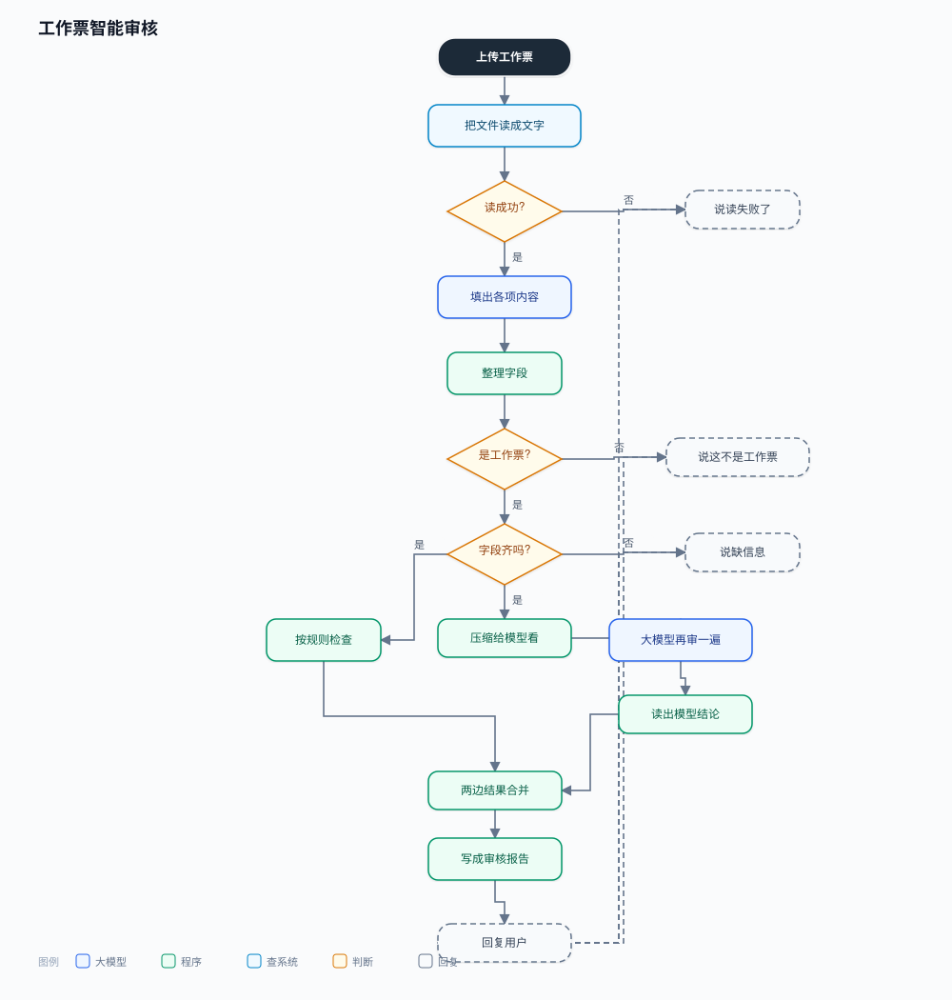
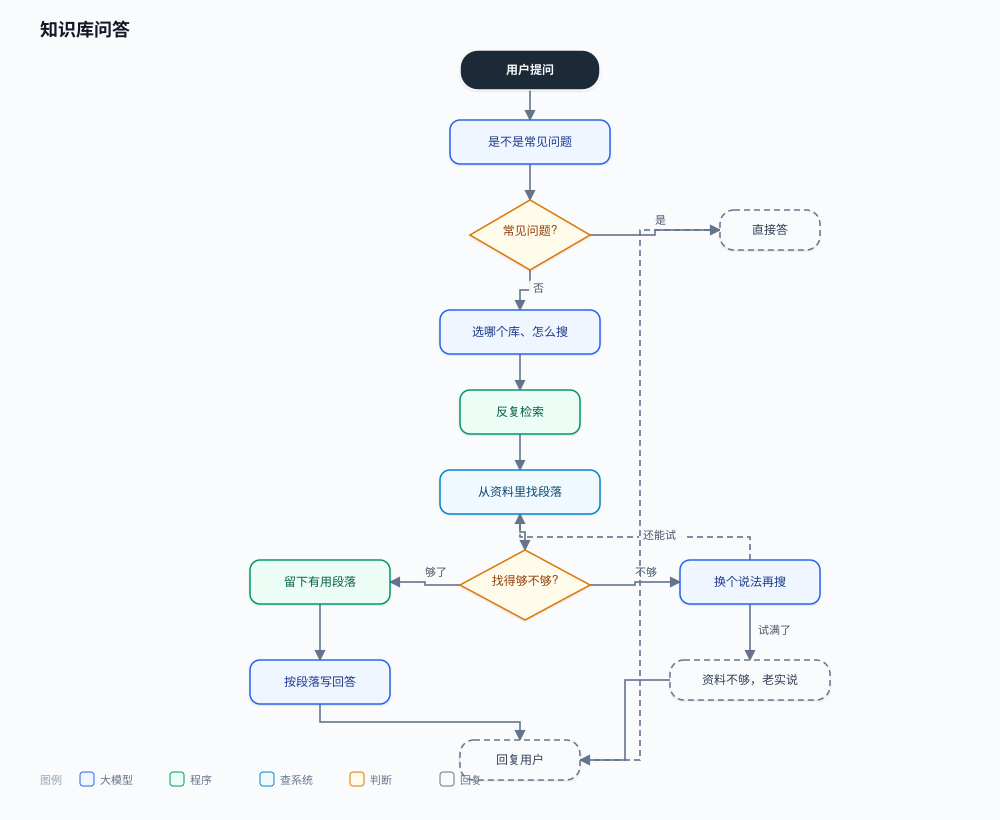
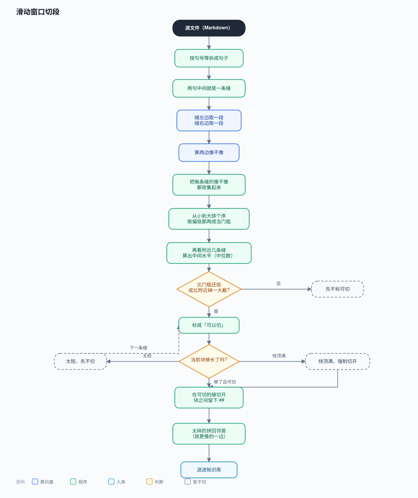
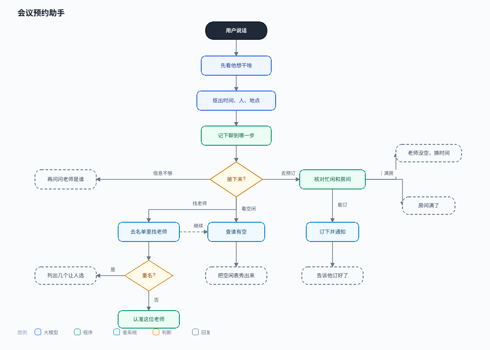

# 智能体开发笔记

这里记我做过的几套智能体：解决什么问题、流程怎么走、提示词怎么改、怎么测、最后怎么交出去。  
每个项目下面直接跟流程图，往下滚就能看。

## 工作票智能审核

施工、维修现场要填工作票。人眼对着规则一条条查，一张大概要几分钟，还容易漏。  
这套流程先把票读成文字，再填出字段，然后**规则和模型一起审**：能写死的用程序查，不好写死的交给大模型。审完拼成报告还给人。  
做过三种票、十几条规则；单张耗时大概从三分钟降到半分钟左右，准一点大概多一成。

→ [项目详情](./projects/work-ticket-audit/)



## 知识库问答

公司规章制度、红头文件很多。问一句「某某情况下怎么做」，要能从资料里找出依据再回答。  
入库前先把文件转成可检索文字，再用**滑动窗口**切成一段段：向量长度有上限，规章又经常没标题，固定切会切乱。问答时常见问题直接答；复杂的就选库、改说法、检索、看找得够不够，不够就再搜，最多几轮。  
大约一万多份文档；一百道题测下来，标准片段进前五的比例从七成四提到九成一，切段帮了大忙。

→ [项目详情](./projects/enterprise-rag/)



入库时怎么切段：



## 会议预约助手

用聊天约老师、约时间、约房间。以前要来回问谁有空、哪间空，现在话聊着就把事办完。  
系统会**记住聊到哪一步**、缺什么信息；改了人、改了时间，旧的校验作废再查，避免旧结果盖住新选择。订之前再核对一遍，通过了才真下单，避免点两次订两次。  
准备了四十多个多轮场景（重名、满房、请假、改口等），完成率大约九成六。

→ [项目详情](./projects/meeting-assistant/)



## 智能问数

用白话问数据库里的数，不必自己写 SQL。  
先认清要查什么；生成语句后**只读执行**；结果不对就重写，最多三次；还是不行就老实说没有，不瞎编数字。

→ [项目详情](./projects/text-to-sql/)

另外还有 [审批催办](./projects/approval-reminder/)、[报税自动填表](./projects/tax-filing-rpa/)。  
自己写的小项目：[MiniCode](https://github.com/gogogo-a/MiniCode)。

## 平时怎么做项目

1. 先搞清楚要解决什么、输入输出是什么、有哪些限制。
2. 再拆流程：哪一步用规则、哪一步用大模型、哪一步调接口。
3. 在平台上搭节点，写提示词，约定数据怎么往下传。
4. 准备测试题，出错就改，改完再跑一遍。
5. 配环境、验收、写文档，交给对方。

## 提交记录

开发过程用 Git 管理。按主题看过哪些提交：

→ [提交记录](./HISTORY.md)

## 本机怎么试跑

会议预约按**线上真实接口**在本地模拟（路径一致；业务已在线上测过）。可本地复现重名、满房、请假等场景：

```bash
cd projects/meeting-assistant/demo/mock-server
pip install -r requirements.txt
python app.py
curl -s http://127.0.0.1:8888/health
```

知识库切段脚本：

```bash
cd projects/enterprise-rag/src
python semantic_chunk_md.py --help
```

## 说明

各项目里有设计说明、测试摘要和流程图。  
通用做法见 [lessons/agent-playbook.md](./lessons/agent-playbook.md)。

仓库地址：https://github.com/gogogo-a/Agent-Portfolio
